# Hoopi automated test results – 17 Nov 2026, 23:44

| Total | ✅ Passed | ❌ Failed | 🐞 Known bug still present | ⏭️ Not run | Run time |
|---|---|---|---|---|---|
| 118 | 96 | 19 | 3 | 0 | 17 min |

**Known bug** = a bug already logged in the test sheet; the test confirms it is still there.

## Failed tests

### ❌ TC-146 Send with an empty box sends nothing

- **Area:** chat
- **Result:** Fail
- **Error:** `Error: locator.innerText: Error: strict mode violation: locator('main') resolved to 2 elements: 1) <main data-slot="sidebar-inset" class="relative flex min-w-0 w-full flex-1 flex-col overflow-x-clip bg-background md:peer-data-[variant=inset]:m-2 md:peer-data-[variant=inset]:ml-0 md:peer-data-[varian`

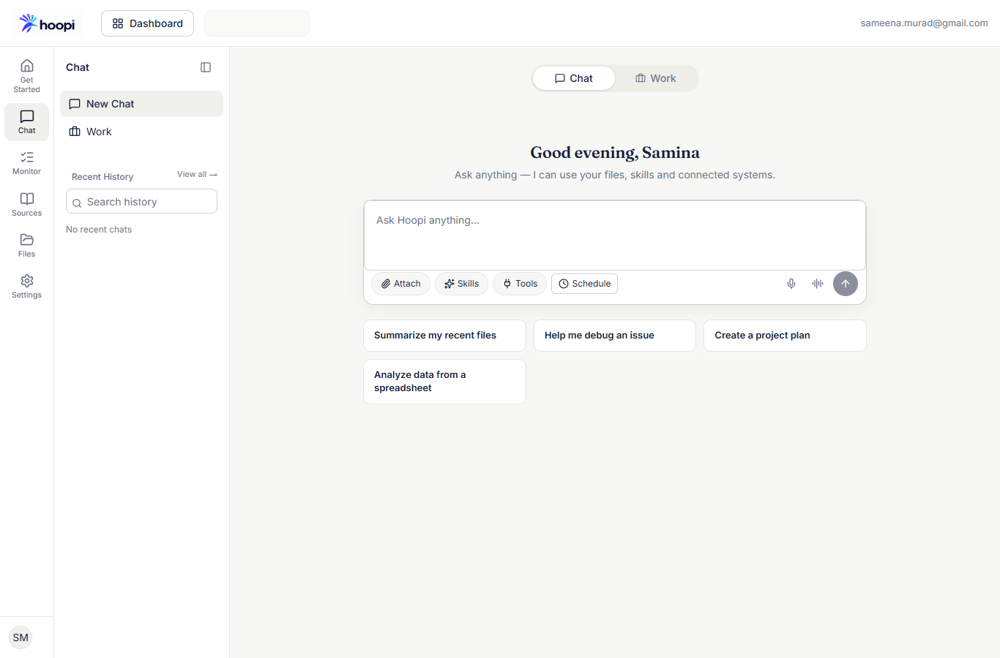

### ❌ TC-201 "All" count = Uploaded + Documents (+ Agent generated)

- **Area:** files
- **Result:** Fail
- **Error:** `Error: expect(received).toBeGreaterThanOrEqual(expected) Expected: >= 5 Received:    0`

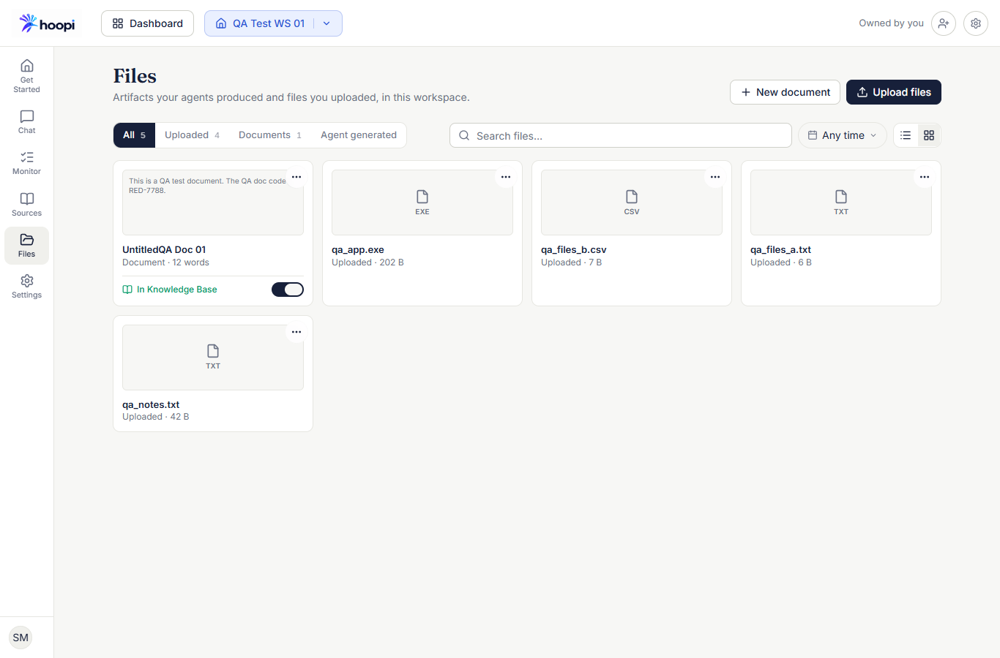

### ❌ TC-205 Download gives the right file

- **Area:** files
- **Result:** Fail
- **Error:** `TimeoutError: page.waitForEvent: Timeout 15000ms exceeded while waiting for event "download" =========================== logs =========================== waiting for event "download"`

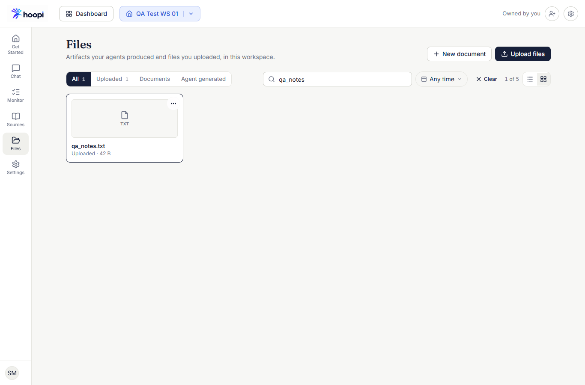

### ❌ TC-067 Book a demo opens Google Calendar in a new tab

- **Area:** khome
- **Result:** Fail
- **Error:** `Error: expect(locator).toHaveAttribute(expected) failed Locator: getByRole('link', { name: 'Book a demo' }) Expected pattern: /calendar\.app\.google/`

### ❌ TC-076 No console errors on load

- **Area:** khome
- **Result:** Fail

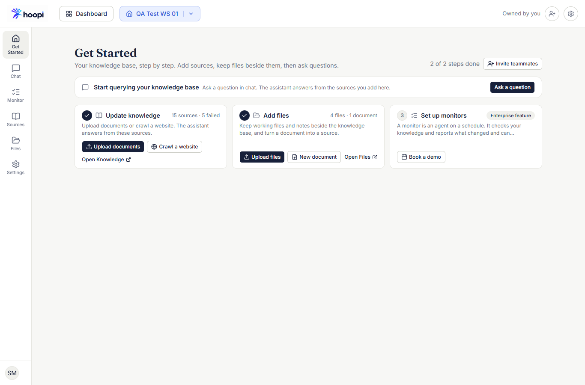

### ❌ TC-046 Defaults: empty URL, 10 pages, depth 2, Q&A off, Start disabled

- **Area:** khome
- **Result:** Fail
- **Error:** `Error: expect(locator).not.toBeChecked() failed Locator: getByRole('dialog', { name: /Crawl a website/ }).getByLabel(/Also generate suggested Q&A/) Expected: not checked`

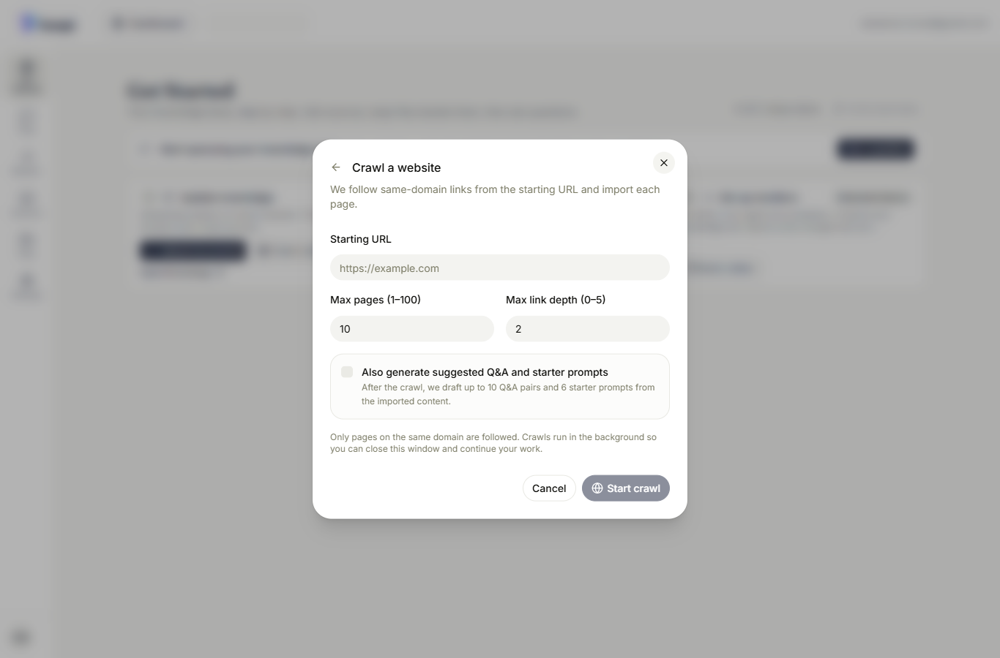

### ❌ TC-184 KHome source count matches Knowledge page

- **Area:** knowledge
- **Result:** Fail
- **Error:** `Error: expect(received).toBe(expected) // Object.is equality Expected: 15 Received: 0`

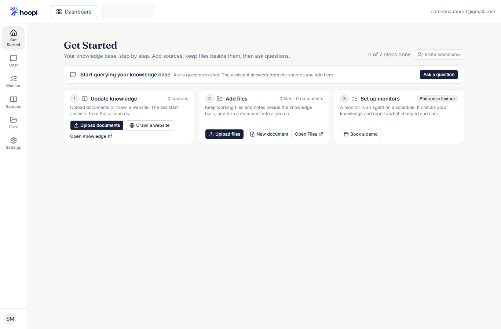

### ❌ TC-160 Monitor page shows stats, filters and format chips

- **Area:** monitor
- **Result:** Fail
- **Error:** `Error: expect(locator).toBeVisible() failed Locator: getByPlaceholder('Search outputs') Expected: visible`

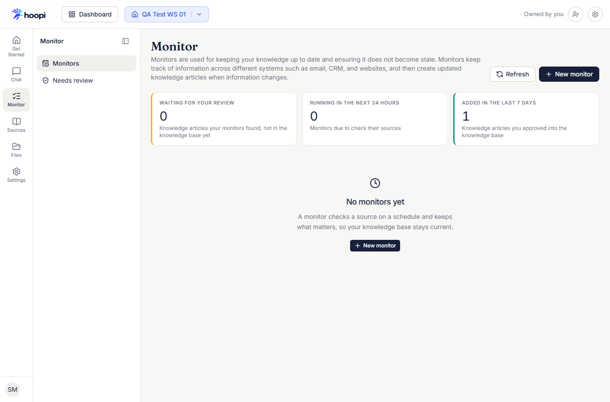

### ❌ TC-161 Card / List view toggle works

- **Area:** monitor
- **Result:** Fail
- **Error:** `TimeoutError: locator.click: Timeout 15000ms exceeded. Call log: - waiting for getByRole('button', { name: 'List view' })`

### ❌ TC-162 Search with no match shows nothing broken

- **Area:** monitor
- **Result:** Fail
- **Error:** `TimeoutError: locator.fill: Timeout 15000ms exceeded. Call log: - waiting for getByPlaceholder('Search outputs')`

### ❌ TC-113 Settings  "Skills" opens the right page

- **Area:** navigation
- **Result:** Fail
- **Error:** `TimeoutError: locator.click: Timeout 15000ms exceeded. Call log: - waiting for getByRole('link', { name: 'Skills', exact: true })`

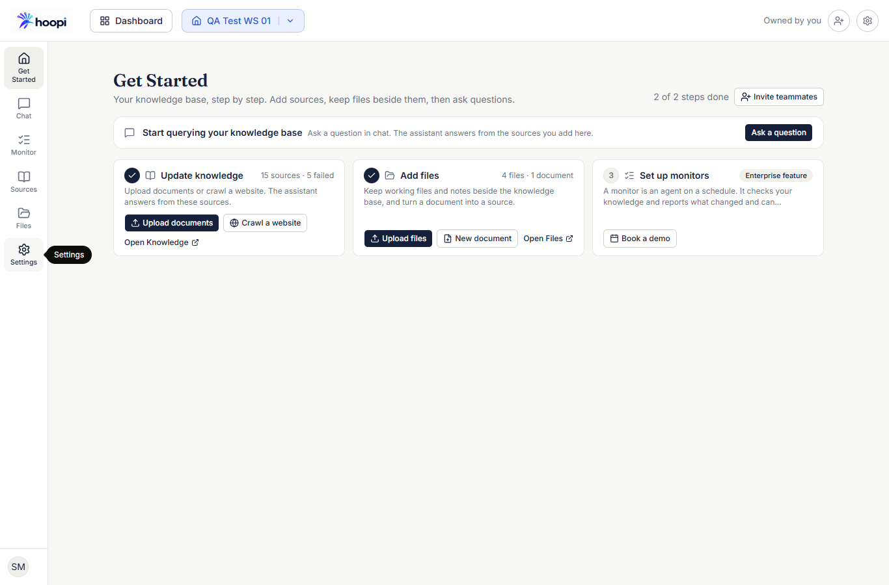

### ❌ TC-124 Toggle Sidebar hides and shows the sidebar

- **Area:** navigation
- **Result:** Fail
- **Error:** `Error: expect(locator).toBeHidden() failed Locator:  getByRole('link', { name: 'Chat', exact: true }).first() Expected: hidden`

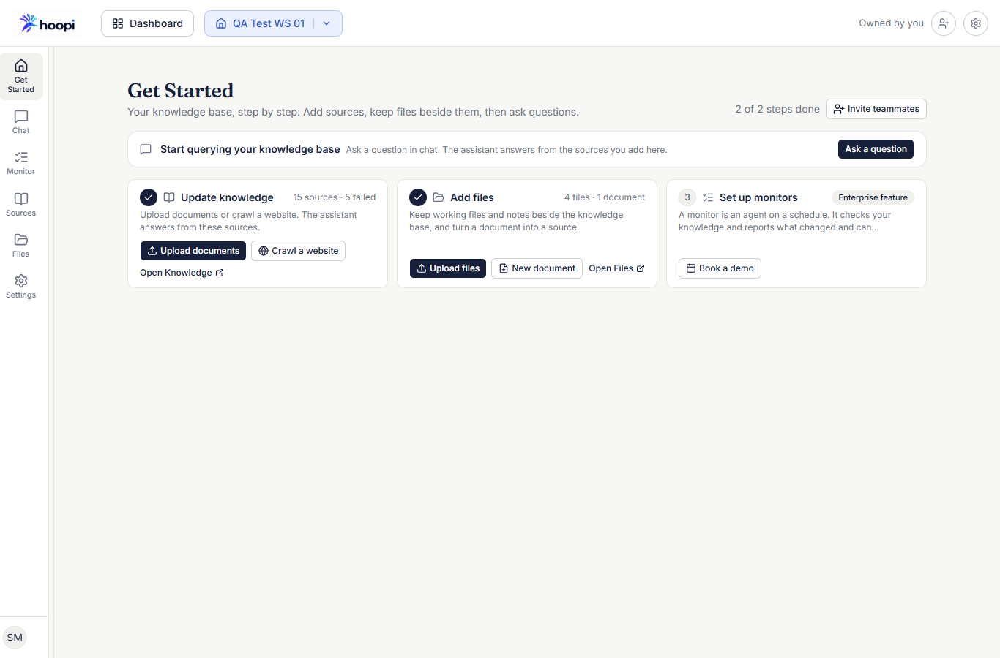

### ❌ TC-221 Date range presets can be selected

- **Area:** settings
- **Result:** Fail
- **Error:** `Error: expect(locator).toBeVisible() failed Locator: getByLabel('Start date') Expected: visible`

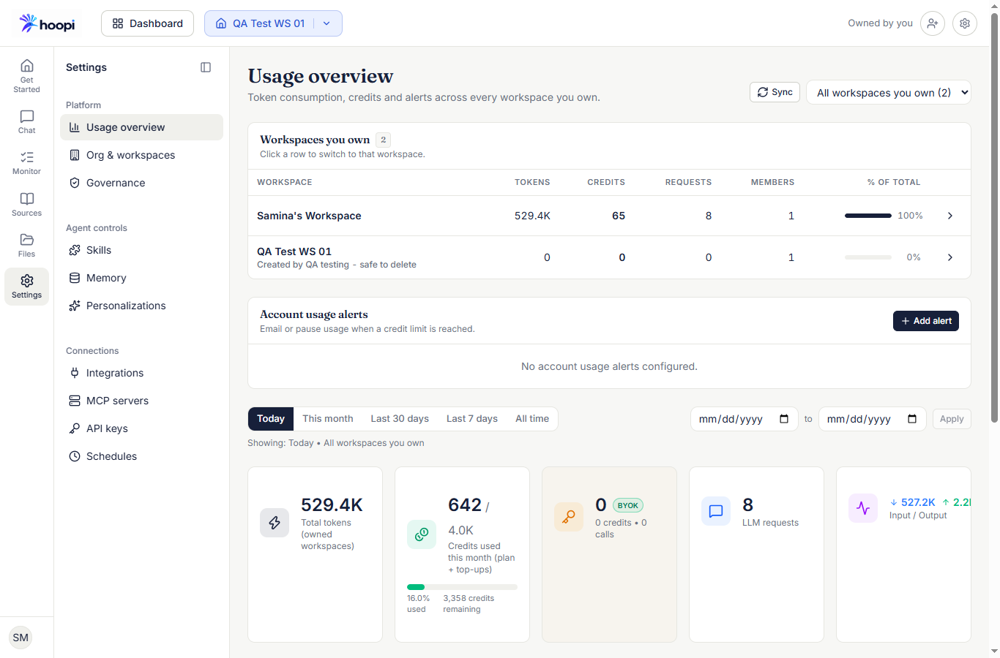

### ❌ TC-222 Custom date range + Apply

- **Area:** settings
- **Result:** Fail
- **Error:** `TimeoutError: locator.fill: Timeout 15000ms exceeded. Call log: - waiting for getByLabel('Start date')`

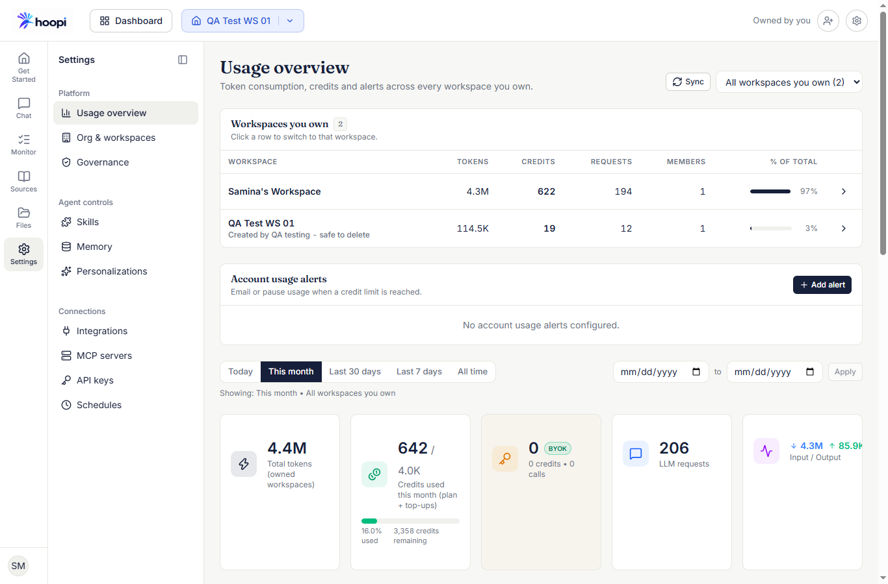

### ❌ TC-223 End date before start date is rejected

- **Area:** settings
- **Result:** Fail
- **Error:** `TimeoutError: locator.fill: Timeout 15000ms exceeded. Call log: - waiting for getByLabel('Start date')`

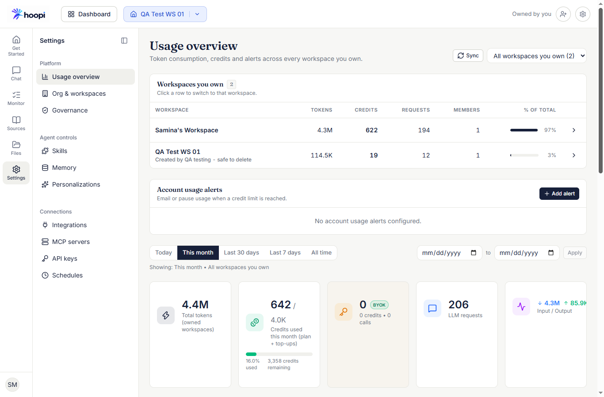

### ❌ TC-245 Members tab has Add people

- **Area:** settings
- **Result:** Fail
- **Error:** `Error: expect(locator).toBeVisible() failed Locator: getByRole('button', { name: 'Add people' }) Expected: visible`

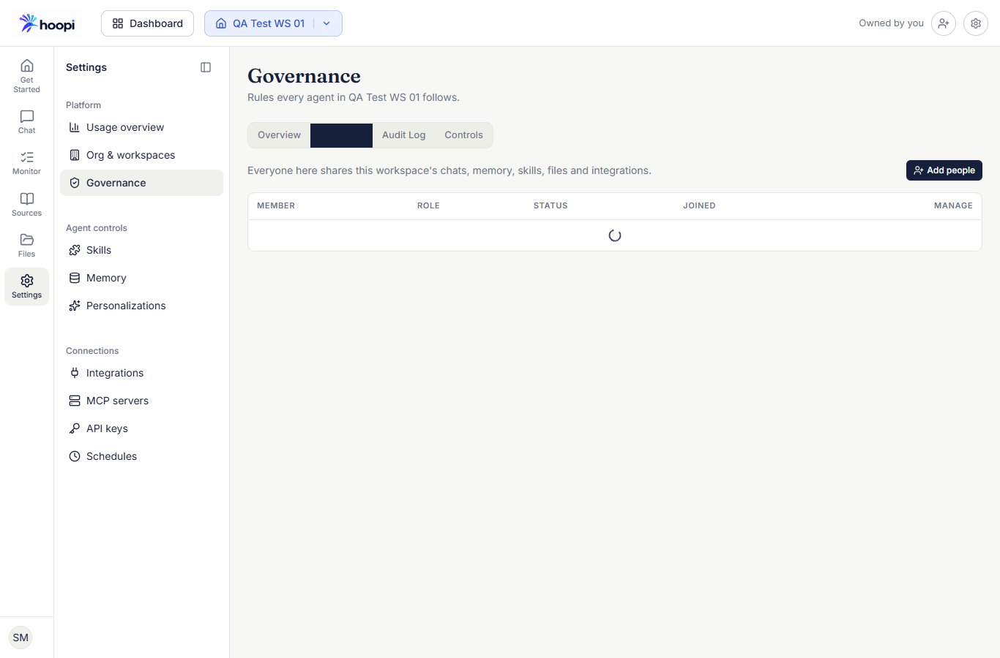

### ❌ TC-263 Built-in skills cannot be deleted

- **Area:** settings
- **Result:** Fail
- **Error:** `Error: expect(locator).toBeAttached() failed Locator: getByText(/defined in the codebase and cannot be deleted/).first() Expected: attached`

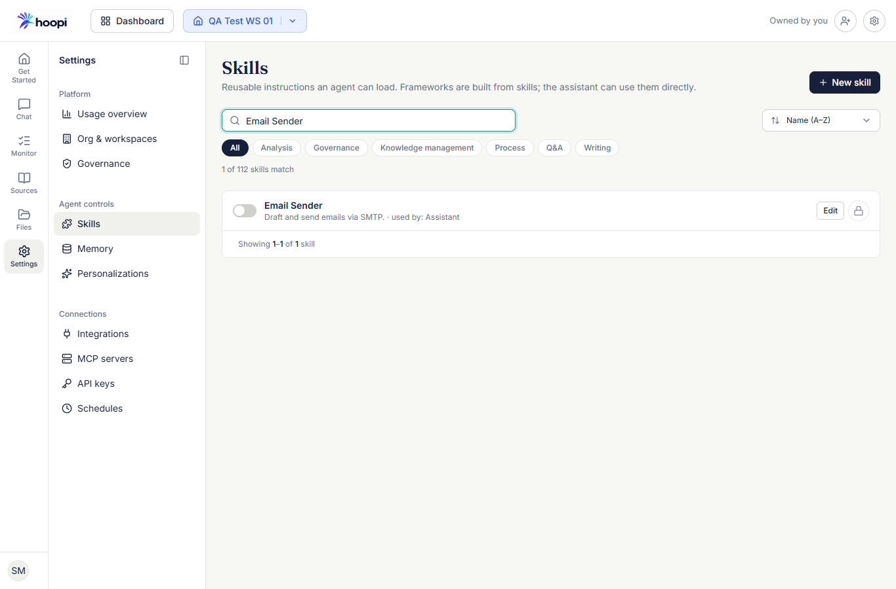

### ❌ TC-283 Invalid metadata JSON is rejected

- **Area:** settings
- **Result:** Fail
- **Error:** `TimeoutError: locator.fill: Timeout 15000ms exceeded. Call log: - waiting for getByRole('dialog', { name: 'New memory' }).getByLabel(/Metadata/)`

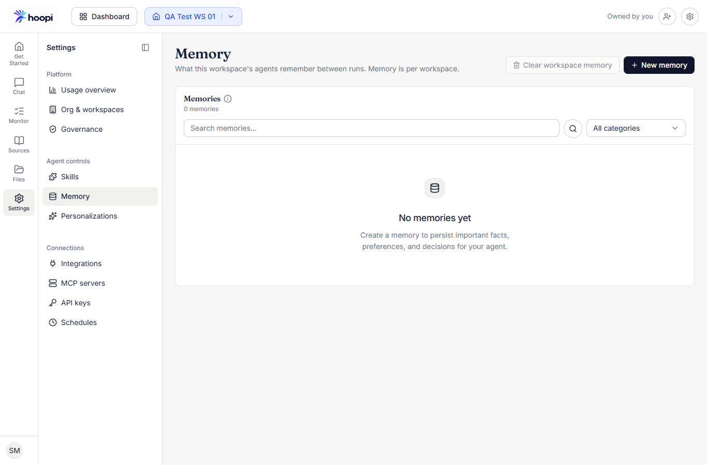

### ❌ TC-301 Model list has options

- **Area:** settings
- **Result:** Fail
- **Error:** `Error: expect(received).toBeGreaterThan(expected) Expected: > 1 Received:   0`

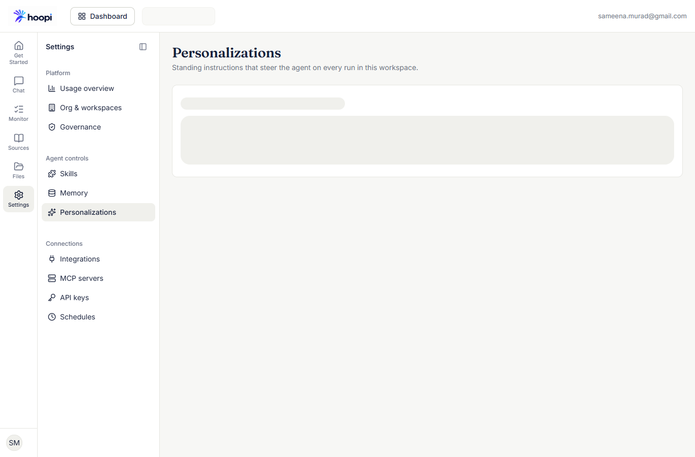

## All tests

| TC | Test | Area | Result | Time |
|---|---|---|---|---|
| TC-140 | Chat page shows input, tools and suggestions | chat | ✅ Pass | 12s |
| TC-141 | Clicking a suggestion fills the message box | chat | ✅ Pass | 5s |
| TC-142 | Skills menu opens (empty state links) | chat | ✅ Pass | 4s |
| TC-143 | Tools menu opens (connect links) | chat | ✅ Pass | 5s |
| TC-144 | Schedule opens the New monitor dialog | chat | ✅ Pass | 5s |
| TC-145 | Work tab opens the Work view | chat | ✅ Pass | 12s |
| TC-146 | Send with an empty box sends nothing | chat | ❌ Fail | 5s |
| TC-200 | Files page shows tabs, search and actions | files | ✅ Pass | 9s |
| TC-201 | "All" count = Uploaded + Documents (+ Agent generated) | files | ❌ Fail | 6s |
| TC-202 | Uploaded tab shows only uploaded files | files | ✅ Pass | 9s |
| TC-203 | Search filters files | files | ✅ Pass | 4s |
| TC-204 | File actions menu: Open, Download, Delete | files | ✅ Pass | 5s |
| TC-205 | Download gives the right file | files | ❌ Fail | 22s |
| TC-206 | Card / List view toggle | files | ✅ Pass | 9s |
| TC-001 | KHome loads with all step cards | khome | ✅ Pass | 3s |
| TC-004 | Refresh keeps the same counts | khome | ✅ Pass | 5s |
| TC-005 | Open Knowledge then browser Back returns to KHome | khome | ✅ Pass | 6s |
| TC-033 | Ask a question opens chat | khome | ✅ Pass | 5s |
| TC-065 | Open Files link opens Files | khome | ✅ Pass | 4s |
| TC-067 | Book a demo opens Google Calendar in a new tab | khome | ❌ Fail | 13s |
| TC-076 | No console errors on load | khome | ❌ Fail | 14s |
| TC-002 | Logged-out user is redirected to login | khome | ✅ Pass | 21s |
| TC-023 | Invite dialog has email, role and buttons | khome | ✅ Pass | 10s |
| TC-027 | Empty email shows "Email required" | khome | ✅ Pass | 6s |
| TC-028 | Invalid email "abc" is blocked | khome | ✅ Pass | 5s |
| TC-028 | Invalid email "abc@" is blocked | khome | ✅ Pass | 4s |
| TC-028 | Invalid email "@test.com" is blocked | khome | ✅ Pass | 6s |
| TC-031 | Esc closes the dialog without sending | khome | ✅ Pass | 4s |
| TC-046 | Defaults: empty URL, 10 pages, depth 2, Q&A off, Start disabled | khome | ❌ Fail | 4s |
| TC-047 | Start crawl enables once a URL is typed | khome | ✅ Pass | 7s |
| TC-051 | Max pages "1" - allowed | khome | ✅ Pass | 4s |
| TC-051 | Max pages "100" - allowed | khome | ✅ Pass | 6s |
| TC-051 | Max pages "0" - blocked | khome | ✅ Pass | 6s |
| TC-051 | Max pages "101" - blocked | khome | ✅ Pass | 5s |
| TC-051 | Max pages "-5" - blocked | khome | ✅ Pass | 4s |
| TC-051 | Max pages "" - blocked | khome | ✅ Pass | 6s |
| TC-052 | Max link depth "0" - allowed | khome | ✅ Pass | 6s |
| TC-052 | Max link depth "5" - allowed | khome | ✅ Pass | 3s |
| TC-052 | Max link depth "-1" - blocked | khome | ✅ Pass | 4s |
| TC-052 | Max link depth "6" - blocked | khome | ✅ Pass | 5s |
| TC-052 | Max link depth "" - blocked | khome | ✅ Pass | 5s |
| TC-052 | Decimal depth 2.5 is rejected | khome | 🐞 Known bug | 13s |
| TC-054 | Invalid URL "example" keeps Start crawl disabled | khome | ✅ Pass | 3s |
| TC-054 | Invalid URL "htp://x" keeps Start crawl disabled | khome | ✅ Pass | 6s |
| TC-054 | Invalid URL "ftp://x.com" keeps Start crawl disabled | khome | ✅ Pass | 4s |
| TC-054 | Invalid URL "abc def" keeps Start crawl disabled | khome | ✅ Pass | 4s |
| TC-057 | Cancel closes without crawling | khome | ✅ Pass | 4s |
| TC-180 | Knowledge page shows counts and actions | knowledge | ✅ Pass | 5s |
| TC-181 | Search filters the document list | knowledge | ✅ Pass | 6s |
| TC-182 | Crawl website button opens the crawl dialog | knowledge | ✅ Pass | 5s |
| TC-183 | "Used by" section lists the Assistant | knowledge | ✅ Pass | 6s |
| TC-184 | KHome source count matches Knowledge page | knowledge | ❌ Fail | 9s |
| TC-185 | Failed sources show a readable error (not raw JSON) | knowledge | 🐞 Known bug | 19s |
| TC-160 | Monitor page shows stats, filters and format chips | monitor | ❌ Fail | 13s |
| TC-161 | Card / List view toggle works | monitor | ❌ Fail | 23s |
| TC-162 | Search with no match shows nothing broken | monitor | ❌ Fail | 22s |
| TC-163 | Refresh keeps the page working | monitor | ✅ Pass | 8s |
| TC-164 | Dialog shows Describe it / Step by step and examples | monitor | ✅ Pass | 4s |
| TC-165 | Picking an example fills the description | monitor | ✅ Pass | 5s |
| TC-166 | Create monitor is not possible with an empty description | monitor | ✅ Pass | 4s |
| TC-167 | Step by step view opens | monitor | ✅ Pass | 4s |
| TC-168 | Cancel closes without creating | monitor | ✅ Pass | 4s |
| TC-169 | Settings  Schedules shows Monitors with counters | monitor | ✅ Pass | 5s |
| TC-101 | Sidebar "Get Started" opens the right page | navigation | ✅ Pass | 3s |
| TC-102 | Sidebar "Chat" opens the right page | navigation | ✅ Pass | 5s |
| TC-103 | Sidebar "Monitor" opens the right page | navigation | ✅ Pass | 5s |
| TC-104 | Sidebar "Sources" opens the right page | navigation | ✅ Pass | 4s |
| TC-105 | Sidebar "Files" opens the right page | navigation | ✅ Pass | 4s |
| TC-110 | Settings  "Usage overview" opens the right page | navigation | ✅ Pass | 7s |
| TC-111 | Settings  "Org & workspaces" opens the right page | navigation | ✅ Pass | 5s |
| TC-112 | Settings  "Governance" opens the right page | navigation | ✅ Pass | 7s |
| TC-113 | Settings  "Skills" opens the right page | navigation | ❌ Fail | 19s |
| TC-114 | Settings  "Memory" opens the right page | navigation | ✅ Pass | 13s |
| TC-115 | Settings  "Personalizations" opens the right page | navigation | ✅ Pass | 6s |
| TC-116 | Settings  "Integrations" opens the right page | navigation | ✅ Pass | 6s |
| TC-117 | Settings  "MCP servers" opens the right page | navigation | ✅ Pass | 5s |
| TC-118 | Settings  "API keys" opens the right page | navigation | ✅ Pass | 6s |
| TC-119 | Settings  "Schedules" opens the right page | navigation | ✅ Pass | 5s |
| TC-106 | Hoopi logo goes to Home | navigation | ✅ Pass | 4s |
| TC-107 | Sidebar "Dashboard" opens executive dashboard | navigation | 🐞 Known bug | 14s |
| TC-120 | Workspace menu lists owned workspaces and actions | navigation | ✅ Pass | 4s |
| TC-121 | Workspace settings menu shows all actions | navigation | ✅ Pass | 3s |
| TC-122 | Account menu shows profile options | navigation | ✅ Pass | 3s |
| TC-123 | Add-people icon opens the invite dialog | navigation | ✅ Pass | 3s |
| TC-124 | Toggle Sidebar hides and shows the sidebar | navigation | ❌ Fail | 15s |
| TC-130 | Home greets the user and lists workspaces | navigation | ✅ Pass | 8s |
| TC-220 | Shows workspace usage table and alerts section | settings | ✅ Pass | 4s |
| TC-221 | Date range presets can be selected | settings | ❌ Fail | 15s |
| TC-222 | Custom date range + Apply | settings | ❌ Fail | 21s |
| TC-223 | End date before start date is rejected | settings | ❌ Fail | 23s |
| TC-224 | By Model / By Channel tabs switch | settings | ✅ Pass | 9s |
| TC-230 | Lists both workspaces with Open and Settings | settings | ✅ Pass | 3s |
| TC-240 | Four tabs open | settings | ✅ Pass | 5s |
| TC-241 | Overview lists the Owner | settings | ✅ Pass | 5s |
| TC-242 | Audit Log has Export JSON | settings | ✅ Pass | 5s |
| TC-243 | Controls shows a switch for every feature | settings | ✅ Pass | 6s |
| TC-244 | Records & Workflows are locked by the platform admin | settings | ✅ Pass | 5s |
| TC-245 | Members tab has Add people | settings | ❌ Fail | 5s |
| TC-260 | Skills catalog loads with a count | settings | ✅ Pass | 10s |
| TC-261 | Search narrows the list | settings | ✅ Pass | 4s |
| TC-262 | Category filters work | settings | ✅ Pass | 6s |
| TC-263 | Built-in skills cannot be deleted | settings | ❌ Fail | 18s |
| TC-264 | New skill dialog: fields and output formats | settings | ✅ Pass | 9s |
| TC-265 | New skill cannot be created with empty name | settings | ✅ Pass | 8s |
| TC-280 | Memory page shows count, search and actions | settings | ✅ Pass | 4s |
| TC-281 | New memory dialog: fields, Cancel | settings | ✅ Pass | 4s |
| TC-282 | Empty memory cannot be created | settings | ✅ Pass | 6s |
| TC-283 | Invalid metadata JSON is rejected | settings | ❌ Fail | 19s |
| TC-300 | All four sections are shown | settings | ✅ Pass | 10s |
| TC-301 | Model list has options | settings | ❌ Fail | 4s |
| TC-302 | Temperature slider stays within range | settings | ✅ Pass | 10s |
| TC-320 | Catalog and Connected sections show | settings | ✅ Pass | 4s |
| TC-321 | Search finds Trello | settings | ✅ Pass | 4s |
| TC-322 | Add custom API dialog requires name and base URL | settings | ✅ Pass | 5s |
| TC-340 | Add server dialog: fields, validation, Cancel | settings | ✅ Pass | 6s |
| TC-360 | Server status and setup guides are shown | settings | ✅ Pass | 2s |
| TC-361 | Setup guide tabs switch | settings | ✅ Pass | 6s |
| TC-362 | Create key dialog needs a label (no key generated) | settings | ✅ Pass | 5s |
